# Update a Companion from the phone (nRF52 Bluetooth or ESP32 Wi-Fi)

For the newer safety checks, explicit reinstall/downgrade picker, wrong-board
recovery, and isolated Tower upgrade evidence, see
[Phone flashing hardening](FLASHING_HARDENING.md). The screenshots below retain
their original test versions; they do not qualify the newer Wi-Fi binding
contract against old firmware.

These are real screenshots from the Android 5.1.1 phone and two Full Companions on the Mercerwood Pi Zero bench: a RAK4631 (nRF52) and a Heltec V4.3 OLED (ESP32-S3). Use **Settings > Update Companion** on the phone. This updates the Companion the phone is directly connected to, not a remote repeater over LoRa.

**Test status:** The ESP32 update from `v1.17.1.5` to `v1.17.1.6` completed, the phone reconnected, and the app displayed the new version. The original RAK4631 nRF52 lab downgrade reached 100% and was verified over USB, but its phone-side reconnection was not verified. A later **T096 Bluetooth upgrade to 1.17.1.9 was verified both over USB and on the reconnected Android 5.1.1 phone**; see the T096 test below. Do not treat the DFU completion screen alone as end-to-end proof.

Keep the Companion powered and the phone charged. Choose an image for the **exact board and role** shown by the app. Do not use a repeater image for a Companion, or an image for a similarly named board. The examples below use the [MeshCore v1.17.1.6 release](https://github.com/mikecarper/MeshCore/releases/tag/v1.17.1.6-halo-keymind-cascade-dev-306feebe); normally select a release newer than the firmware already installed on *your* Companion. If the app's GitHub lookup is unavailable, download the exact release asset into the phone's Downloads and use **Phone Downloads** or **Browse files**. No command line is needed for the normal phone procedure.

## nRF52: Bluetooth DFU ZIP

1. Connect **directly over Bluetooth** to the nRF52 Companion. In **Settings > Update Companion**, check the board name. The RAK4631 test radio displays **RAK 4631** and **Nordic DFU .zip - Bluetooth update**. Expand **Installed firmware** to check its starting version.

   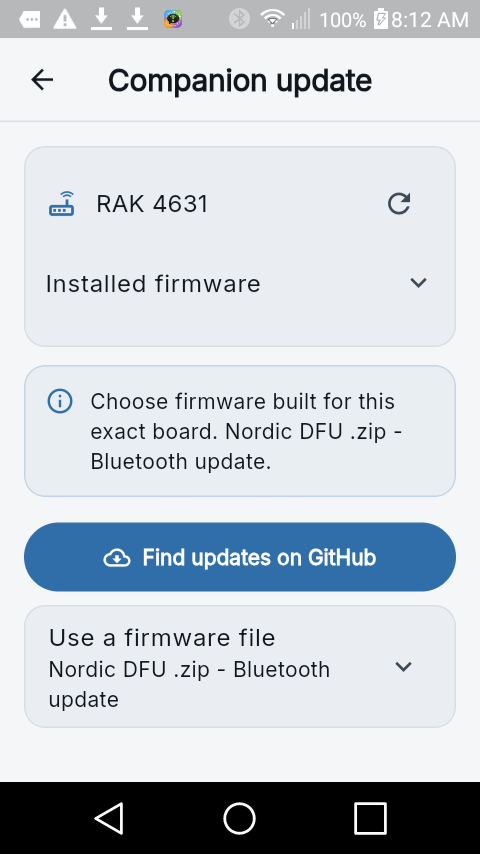

2. Choose a board-matched **application DFU `.zip`** from GitHub or the phone. For this test, the file name began `RAK_4631_companion_radio_full-`. The ZIP's manifest contained an `application` image only; it did not install a SoftDevice or bootloader. Do not extract the ZIP, choose a `.bin`, or assume an application ZIP can repair an incompatible bootloader. Confirm the app's selected-file card names the intended RAK 4631 package.

   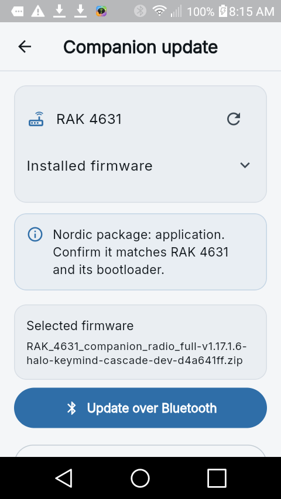

3. Tap **Update over Bluetooth** and read the confirmation. Check the board, package, and Bluetooth address. The app also shows the last reported battery voltage when it is above 0 V; the test radio reported 4.26 V. Keep the device powered and nearby, then tap **Update**.

   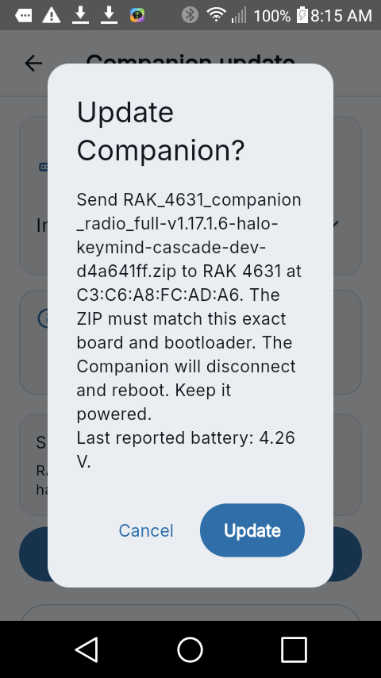

4. Wait for the transfer to reach 100%. Do not leave the app, disconnect Bluetooth, or remove power. The app releases the normal Companion connection before DFU and checks for the radio's bootloader, including its expected changed Bluetooth address. After a connection timeout before transfer/validation progress, it scans again and makes at most one additional attempt against an identified bootloader. It does not select a different nearby radio just because its name matches.

   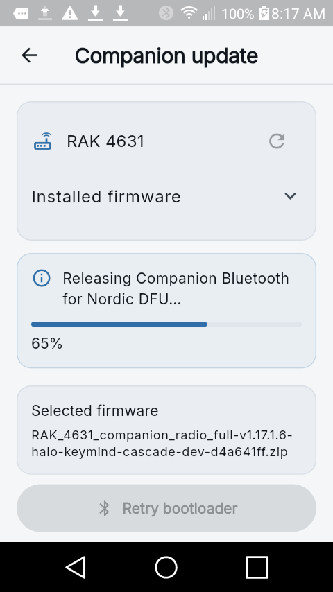

   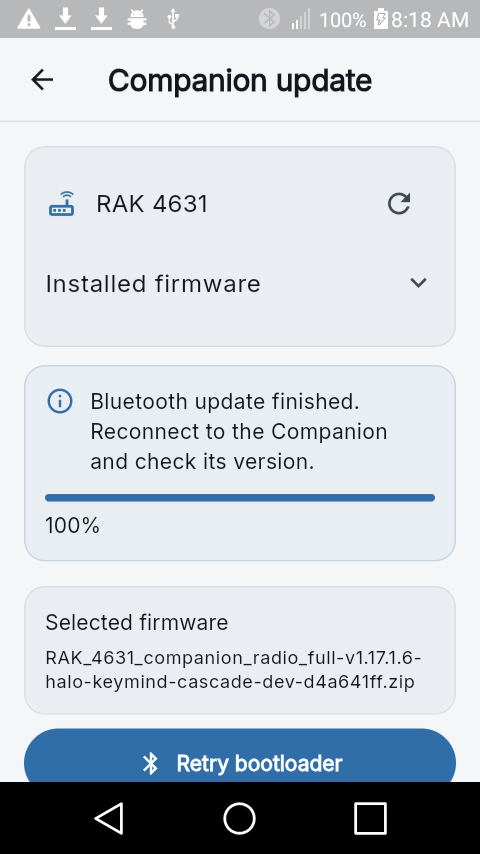

5. After the Companion reboots, use **Connect** and select the same radio in the scanner. If Android asks to pair again, use the PIN shown by your device or provided by its administrator; do not put the PIN into firmware files, screenshots, or this guide. Return to **Settings > Update Companion**, expand **Installed firmware**, and confirm the new version. A 100% DFU screen without this last check is not sufficient verification.

### T096 or other nRF52: recovering a GATT connection timeout

If the app reports `GATT CONN TIMEOUT`, keep the radio powered. If automatic recovery cannot find the bootloader, enter **BT OTA** mode using the board's controls, then tap **Retry bootloader** in the same Companion update screen. The retry performs a new scan rather than reusing an old scan result. For the Oltaco T096 bootloader the advertised name is `T096_DFU`; the app checks both the original address and the expected bootloader address. If it finds neither, or finds two matching candidates, it stops without making another firmware attempt.

An installed bootloader and the running Companion application are separate. Older applications may fail to switch into DFU even with a working bootloader; installing another bootloader UF2 does not replace the application's handoff callback. Manual BT OTA entry bypasses that handoff. A board-matched application update containing the corrected handoff may be needed once. Do not erase the radio's settings, delete Bluetooth bonds, or install a SoftDevice just to troubleshoot this timeout.

The recovery change has automated coverage in both Android profiles. The RAK4631 screenshots earlier in this guide are from the earlier bench test. The later physical T096 run is described separately below. Verify the installed version after every update.

### T096 physical upgrade test - 12-Oct-2026

The Mercerwood Pi Zero T096, USB serial `651F8E496197F882`, started on `Companion v1.17.1-t096-full-head-fdd67ce1` (build 30-Sep-2026). Android 5.1.1 phone `LGL51AL2814ba19` installed the MC Open DFU-recovery APK and connected to `MeshCore-B861B9C8` at `CF:A8:18:36:DE:8B`. Its current pairing PIN was read privately from the radio; no credentials were added to the app or this guide.

The phone selected the exact `Heltec_t096_companion_radio_full_femon-v1.17.1.9-halo-keymind-cascade-dev-88c85108.zip` application package from the [1.17.1.9 Companion release](https://github.com/mikecarper/MeshCore/releases/tag/v1.17.1.9-halo-keymind-cascade-dev-88c85108). The manifest contained only `application`, with SoftDevice requirement 182. The confirmation showed the intended board/address and 4.23 V battery reading.

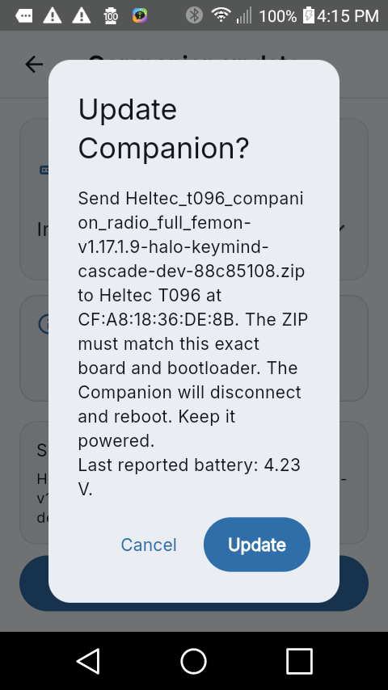

Android logged GATT status 8 during handoff at 16:16:13 phone-local time. The Nordic SDK recovered using the same address and the transfer continued. This physically tests the SDK's same-address timeout recovery, not the additional app-side changed-address scan/retry; that selection and manual-entry path have automated regression coverage. The transfer finished at 16:17:47.

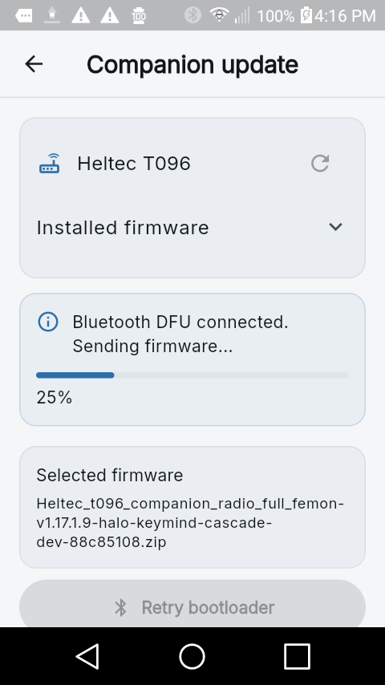

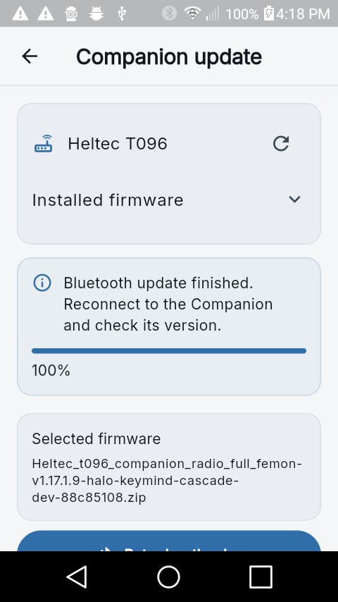

The initial APK required pairing again after DFU because the native SDK's default removes the phone bond. After normal Android pairing, the phone reconnected and **Installed firmware** displayed `Companion v1.17.1.9-halo-keymind-cascade-dev-88c85108` (build 07-Oct-2026), matching the Pi's USB query. The same node name and Bluetooth address remained. No erase, bootloader replacement, SoftDevice replacement, or settings reset was performed.

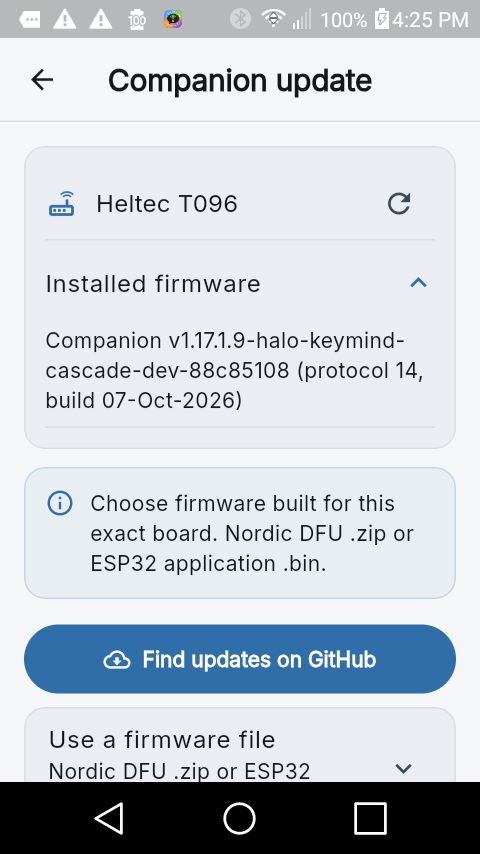

Testing also exposed an omitted T096 board-format entry; the follow-up code now identifies this board as Nordic DFU ZIP over Bluetooth. Application-only updates also request native bond retention. System-component updates do not request that retention. [Nordic documents the supported legacy bootloader requirements and limitations](https://github.com/nordicsemi/Android-DFU-Library/blob/2.11.0/lib/dfu/src/main/java/no/nordicsemi/android/dfu/DfuServiceInitiator.java); retaining a bond is not proof that the DFU link is encrypted.

The same-version follow-up application transfer completed at 16:38:23 phone-local time with bond retention enabled. Android retained the pairing but cached the bootloader's GATT services, preventing a normal NUS connection. The final app now inspects services before subscribing to Service Changed. On Android, if it finds legacy DFU but no NUS, it refreshes only that radio's service cache, waits one second, and rediscovers once. A device still genuinely in DFU is not treated as a Companion. No bond is removed.

Installing the final APK into that existing cached state physically verified recovery: Android logged `BluetoothGatt.refresh()` at 16:59:51, rediscovered the application services, and subscribed to NUS at 16:59:53. The phone reconnected without another PIN prompt and read the installed 1.17.1.9 version again. This follow-up preserved the same node identity/name and Bluetooth address. It did not erase storage, reset settings, or replace the bootloader.

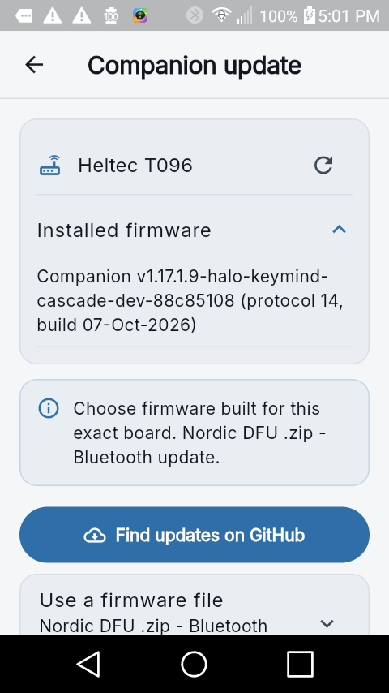

Both Android profiles passed 1,045 tests with two optional skips, and the new service-cache policy has regression coverage for ordinary devices, non-Android platforms, real bootloader mode, and failed refreshes. All three connected Android 5.1.1 phones answered ADB at the final check. Their USB configuration was already 2; reconnecting only the stalled `LGL51AL2814a411` transport restored command responses, without phone reboots or changing other transports.

### Isolated Mesh Tower follow-up

The Mesh Tower V2 uses nRF52840/S140 6.1.1 and a Nordic application ZIP, not
an ESP32 Wi-Fi BIN. Its bootloader can advertise the full `TOWER_V2_OTA` name
or the shortened `TOWER_V2` name. The follow-up recovery code recognizes only
those Tower names at the selected radio's original or expected bootloader
address, with the legacy DFU service and no Companion NUS service.

Fresh service advertisements replace older observations. In particular, an
application NUS advertisement must not remain attached to that address after
the bootloader starts advertising. Name-only phase changes are not sufficient
proof of a bootloader and are kept unselectable until fresh service evidence
arrives. Neither change permits choosing an arbitrary nearby radio.

For the Mercerwood follow-up, the selected Tower is USB serial
`9352162A72082314`, named `HIL-TOWER-SD`, and answered `ver` with
`v1.17.1.9-hil-nrf-7d3ee720-7d3ee720` (build 05-Oct-2026). Initial inspection
was read-only. This was a repeater test image, so the Tower was deliberately
prepared with its exact-board `Heltec_tower_v2_companion_radio_full` application
before testing the Companion updater. Its existing bootloader reported
`OTAFIX2.4.11-preview.2`; it was not replaced. Both USB preparation and later
restoration used verified application-only ZIPs requiring S140 6.1.1. No
SoftDevice payload, bootloader payload, or erase firmware was used.

The isolated test APK used package `com.meshcore.meshcore_open.towerdfutest`
on Android 5.1.1 phone `LGL51AL2814a411`, leaving the installed production app
and its remembered radios unchanged. To expose ADB, only that phone's MTP
holder was released, then `usb_modeswitch` selected configuration 0 followed
by configuration 2. Direct configuration-2 attempts had failed; a USB device
reset alone did not substitute for this transition. The separate game-test
phone and the T096/RAK4631 Morse-test serial ports were not operated.

1. Pair to the verified Tower, `MeshCore-931C5D57` at `F1:58:C8:21:01:6F`.
   The pairing PIN was read privately over its Pi USB port, never added to the
   app, tutorial, or exported trace. Select the exact Tower Companion ZIP in
   **Phone Downloads**. The app identifies the board as Nordic ZIP/Bluetooth.

   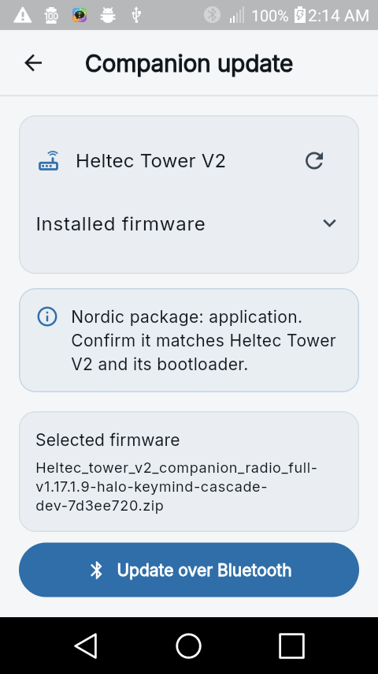

2. Tap **Update over Bluetooth** and verify the board, address, and application
   package in the confirmation. The bench Tower remained USB-powered. Its
   last reported battery voltage, 2.96 V, appeared in the confirmation.

   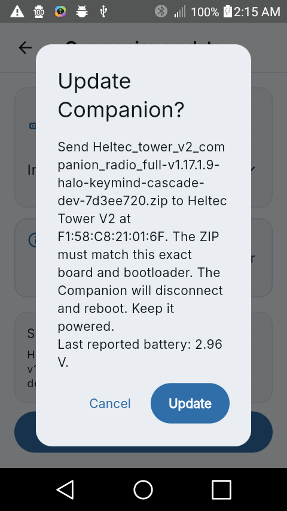

3. Keep the updater open until completion. The native Nordic 2.11.0 SDK
   handled the same-address application-to-bootloader handoff. The exported
   trace recorded payload progress from 1% through 100%; the whole DFU call
   took approximately 107 seconds, with about 77 seconds of payload transfer.
   An early 0% snapshot was not evidence of a stuck transfer.

   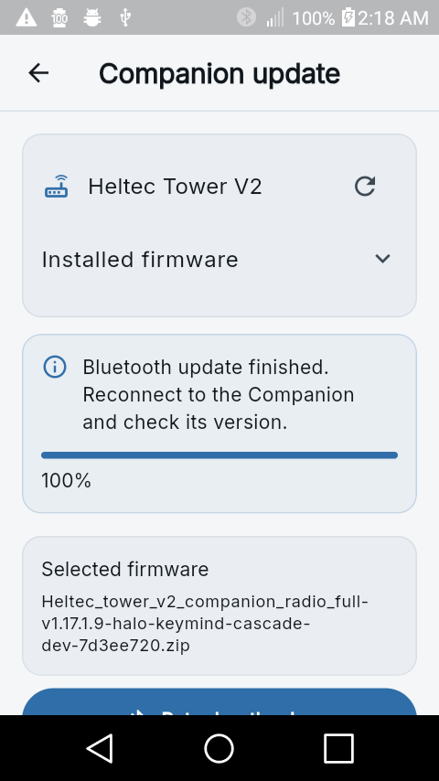

4. Reconnect to the same Tower and reopen **Installed firmware**. The phone
   reconnected without another PIN prompt and read
   `Companion v1.17.1.9-halo-keymind-cascade-dev-7d3ee720` (protocol 14,
   build 05-Oct-2026). This was an intentional same-version application
   transfer, not an upgrade to a different release.

   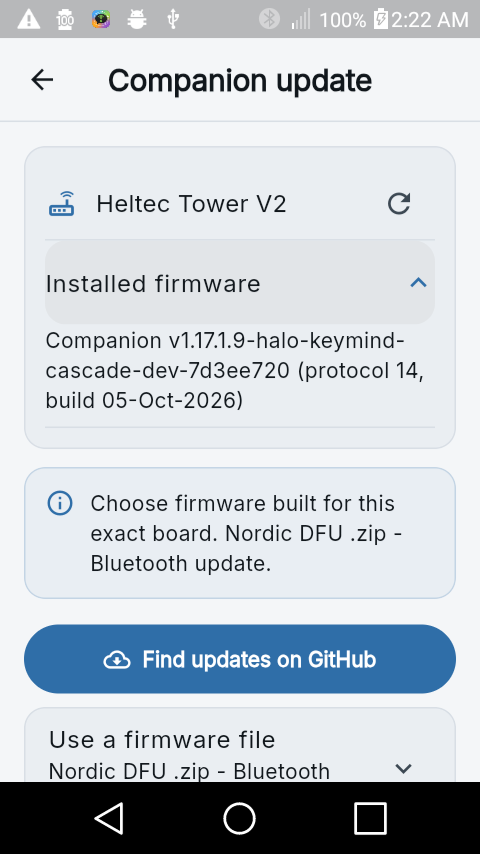

The isolated app was disconnected and stopped after the test. The original
Tower SD repeater application was restored through verified application-only
USB DFU. Its running version, `HIL-TOWER-SD` name, `910.5250244,62.5,7,5` radio
tuple, and reported bootloader version matched the pre-test queries. This is
not a backup or comparison of every setting. The Morse-test radios were
neither reflashed nor reconfigured.

The follow-up Companion updater also records a `CompanionDFU` phase trace in
the app's existing exportable debug log. It distinguishes bootloader discovery,
handoff, payload transfer, validation, and recovery, with bounded native error
codes when available. Raw native error details, file paths, firmware contents,
passwords, PINs, and private identity keys are not exported by this trace. A
completed DFU trace still requires reconnecting and checking the installed
version. These follow-up changes are not part of the already published RC6
APK; do not assume that RC6 has the new trace or Tower recognition.

Both Android source profiles passed 1,206 tests with five optional skips, and
targeted analysis found no issues. This Tower run qualifies the shared Nordic
Companion handoff, transfer, and phone reconnection. It does not qualify the
reporter's exact T096/T114 hardware with Oltaco 2.3, prove the cause of that
report, or exercise the app's changed-address recovery selection: the native
SDK completed at the original address. Tower-name and fresh-advertisement
recovery have regression tests but no separate hardware fallback result in
this run. See the [sanitized Tower test evidence](test-results/tower-companion-dfu.json).

## ESP32: Wi-Fi application BIN

1. Connect to the ESP32 Companion, then open **Settings > Update Companion**. Check the exact board and the installed version. The test device reported **Heltec V4.3 OLED** and `v1.17.1.5`.

   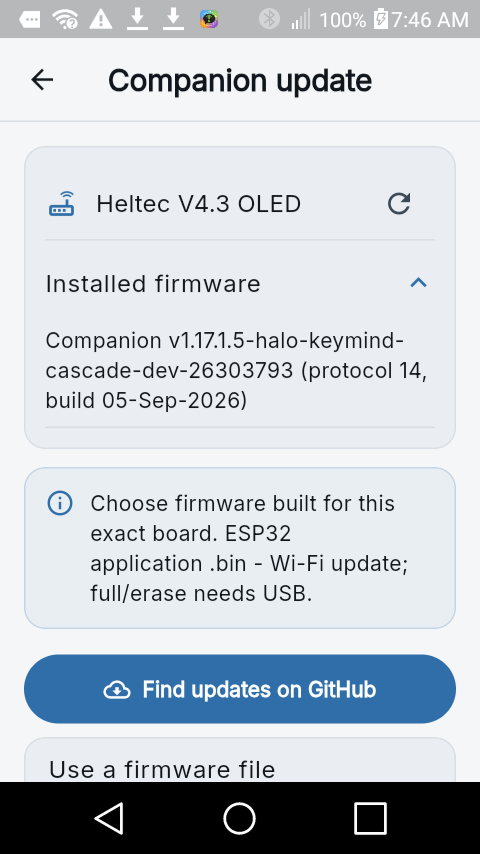

2. Select the matching **application `.bin`**, here `heltec_v4_2_v4_3_companion_radio_full_femon-...v1.17.1.6...bin`. Check the app's hardware match before proceeding. Do **not** use a merged, full-flash, or erase image for Wi-Fi OTA; those require a board-specific USB installation. The phone checks whether the application fits the radio's OTA slot before starting the updater. If it says partition expansion or USB preparation is required, stop and follow that separate procedure first; do not force the upload.

   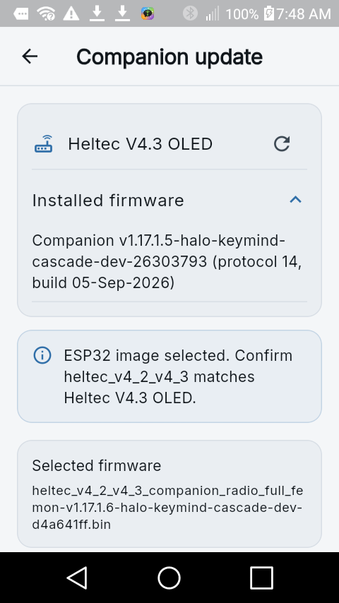

3. Tap **Start Wi-Fi updater**. The app starts the radio's lightweight updater and reports the OTA slot capacity. In this test it read a 6400 KB slot from the radio and accepted the selected image. The updater address shown here is local to the radio's temporary Wi-Fi network.

   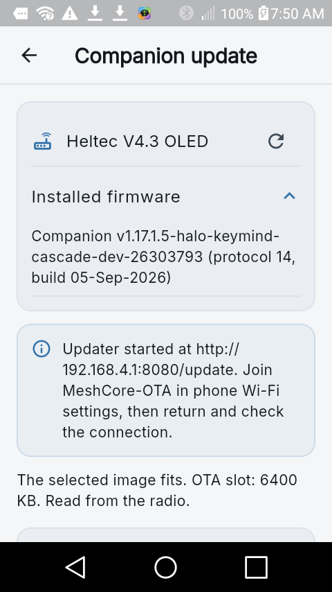

4. Tap **Open Wi-Fi settings** and join **MeshCore-OTA**. This lab updater advertised an open Wi-Fi network; do not assume every device uses the same security setting. Android may warn that the network has no Internet, or open a captive-portal page. That is expected for a local updater. Stay connected to **MeshCore-OTA**, then return to the app.

   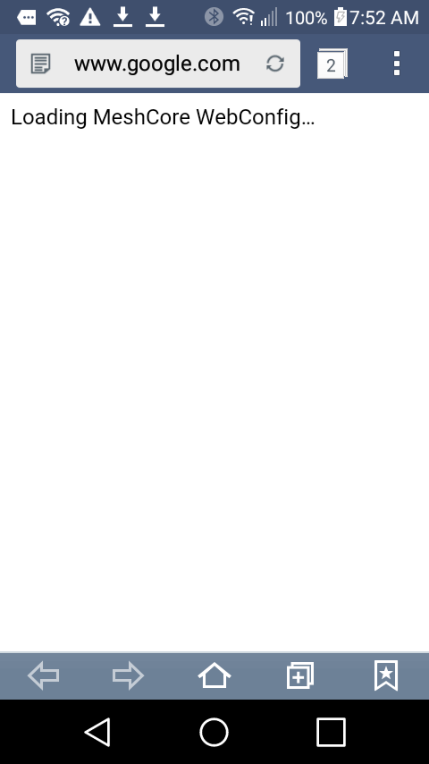

5. Tap **Check Wi-Fi connection**. Proceed only after the app says it is connected to the MeshCore lightweight updater. If the check fails, verify the phone is still on **MeshCore-OTA**, not its usual Wi-Fi or mobile data.

   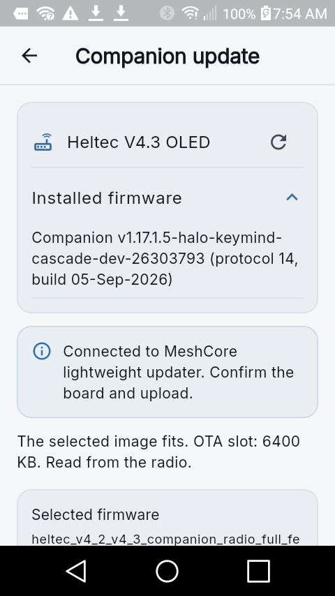

6. Tap **Upload firmware** and read the confirmation. It must name the same board, the intended application `.bin`, and a fitting OTA slot. Tap **Update**, keep the app open, and wait for **Upload accepted**. That message means the updater accepted the image; the reboot and installed version still need checking.

   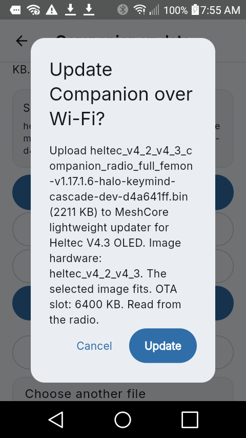

   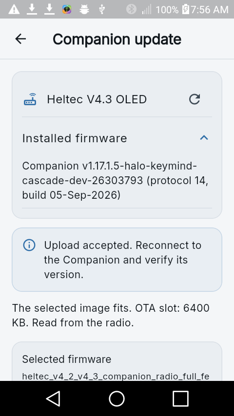

7. Let the radio reboot and reconnect to it. Return to **Settings > Update Companion** and expand **Installed firmware**. The Heltec V4.3 test radio then reported `v1.17.1.6-halo-keymind-cascade-dev-d4a641ff`, confirming the upgrade from `v1.17.1.5`. Rejoin your normal Wi-Fi network afterward if the phone does not switch back automatically.

   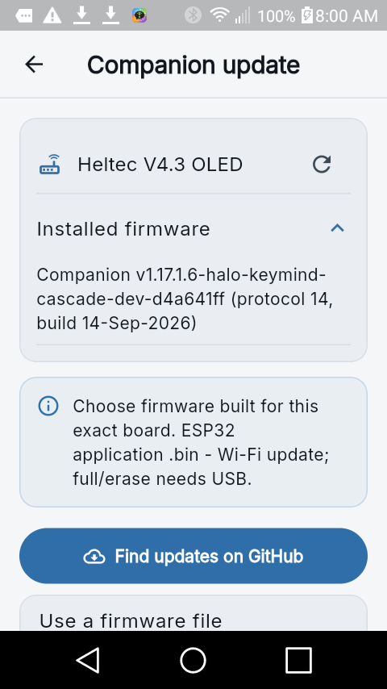

## What the bench test did and did not prove

The ESP32 screenshots show the complete phone procedure: both firmware versions, board and OTA-slot checks, local Wi-Fi connection, accepted upload, and post-reboot version verification. The `v1.17.1.5` baseline came from the [board-matched v1.17.1.5 release](https://github.com/mikecarper/MeshCore/releases/tag/v1.17.1.5-halo-keymind-cascade-dev-26303793), and the replacement came from the linked v1.17.1.6 release. The phone downloaded neither through an embedded secret; the files were placed in Downloads for this lab because the GitHub lookup on this Android 5.1.1 phone had previously failed DNS.

The nRF52 screenshots exercise a **lab downgrade** from a newer RAK4631 build to the v1.17.1.6 application ZIP to test Bluetooth DFU; they are not a recommendation to downgrade. The phone reported 100% and the Pi's USB service port reported `Companion v1.17.1.6-halo-keymind-cascade-dev-d4a641ff` after reboot. The older firmware could not initially save its Bluetooth PIN after the downgrade. Because this specific bench radio was designated erasable, its local file system was erased, a PIN was set again through the Pi service port, and it was rebooted. Even then, the Android 5.1.1 phone did not re-establish pairing during this run. That lab repair is **not** part of the normal phone tutorial, and the phone-side nRF52 final version check remains unverified. Do not erase a deployed radio merely because a DFU pairing attempt fails; preserve its data and diagnose the board, bootloader, PIN, and phone bond first.

The two update paths are distinct: nRF52 uses a board-matched **Nordic DFU ZIP over Bluetooth**; ESP32 uses a board-matched **application BIN over the radio's temporary Wi-Fi**. Neither path is the remote repeater [LoRa OTA procedure](LORA_OTA_REPEATER_TUTORIAL.md), and neither application update should be mistaken for a bootloader or partition-table installation.
