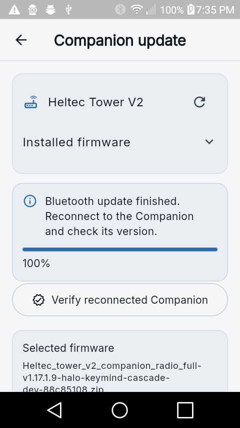
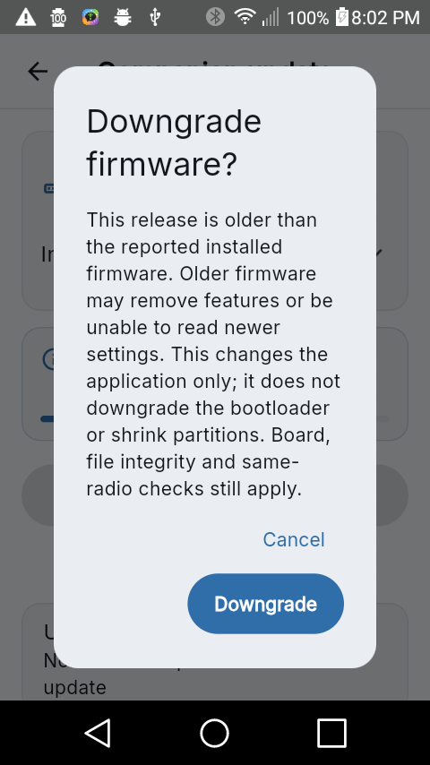
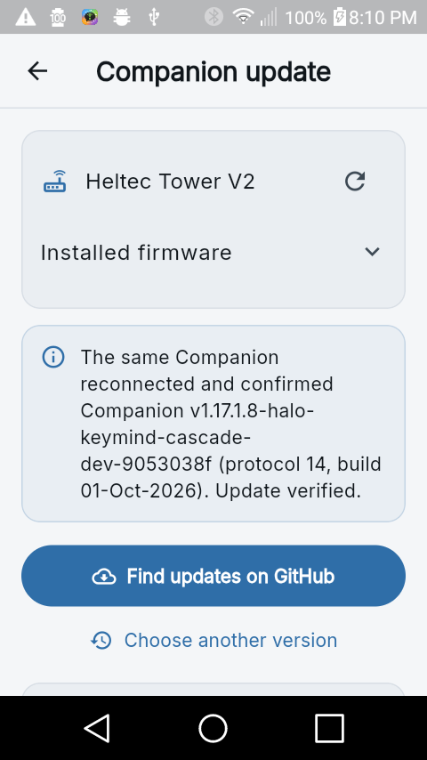
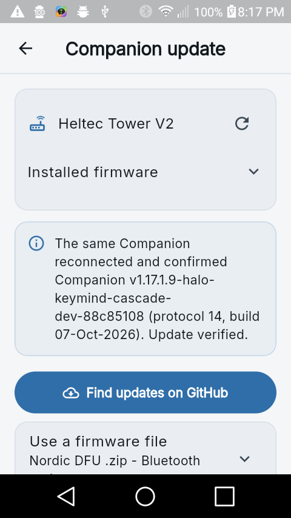

# Phone flashing hardening

These changes are on `codex/flashing-hardening`, with receiving-firmware and
nRF52 handoff changes on MeshCore's `codex/companion-ota-binding` branch. They
are not automatically present in an already published release APK.

## Selecting a version

Use **Settings > Update Companion > Find updates on GitHub** for the latest
verified Full Companion release for the exact board. An equal numeric version
is labeled **Same version - reinstall** and requires an explicit confirmation;
it is not incorrectly described as an older release. Equal version numbers do
not prove that two builds have identical features or contents.

Use **Choose another version** to include older compatible releases in the
picker. The lookup examines the repository's 30 most recent release records.
Selecting **Older version - downgrade** opens a separate confirmation before
downloading. A downgrade can remove features or encounter incompatible saved
settings. It changes the application, not the bootloader, SoftDevice, or
partition layout. A very old application may also need USB/manual bootloader
entry for its next update.

Older files still need the same exact-board, role, digest, image, and transport
proof. Missing release metadata is not waived to populate the history. Full
Companion lookup does not silently substitute a BLE-only build. If a historical
release has no verifiable wireless package, use a separately reviewed exact-board
wired installation instead.

## What can be overridden

The board label reported by an application is not independent hardware proof.
If incorrect firmware was installed, expand **Installed firmware** and use
**Wrong board reported?**. For a connected Nordic Companion with a fresh,
writable DFU service, choose the physically verified board and explicitly
confirm its model. This clears the previous package selection and checks the
replacement against the corrected model. The public node identity must remain
the same. An unsupported or non-Nordic wireless recovery goes to the USB
installer instead.

This is not a generic **force flash** switch. Corrupt ZIPs, checksums, ESP image
framing, wrong chips, wrong board variants, unsupported SoftDevices, invalid
vectors, oversized slots, conflicting identities, and unconfirmed active
transfers remain blocking checks. A downgrade confirmation does not override
any of those checks.

## Bluetooth handoff and recovery

- On Android, refresh this radio's GATT cache and send the application DFU
  opcode over the existing authenticated Companion connection. Stop its normal
  polling/reconnect path before sending the opcode.
- A reboot may consume the opcode but lose the write acknowledgment. A bounded
  write timeout or recognized Android link-loss status may proceed to independent
  bootloader discovery; it does not establish update success. Authentication,
  subscription, and unrelated write errors still stop the handoff.
- Select only the original, expected incremented, or independently verified
  address with fresh board-specific legacy DFU evidence and no application NUS.
  Ambiguous nearby candidates stop the update.
- A bonded Adafruit bootloader can be non-discoverable. If scanning misses it,
  probe only the original address already bonded by Android. Clear its cached
  services and read the bootloader revision, exact board name, and required
  characteristics. Disconnect the read-only probe before the native transfer.
- One shared coordinator owns native DFU. It has inactivity and overall limits,
  confirms cancellation, and never automatically replays a partially sent
  payload. A lost terminal result blocks another transfer.
- A validated ZIP and public identity survive app restart for 24 hours. An
  unconfirmed native lease is not discarded merely because a ZIP expired or
  became unavailable. Android's **Recover Bluetooth update** route requires
  independent native-service termination proof before releasing that guard.
- After reboot, reconnect to the same Companion and tap **Verify reconnected
  Companion**. This checks its public identity and board, plus its firmware body
  hash when present, before clearing the saved recovery record.

Opaque iOS identifiers retain the native SDK handoff and are accepted by saved
recovery records. Android MAC arithmetic and bonded GATT probing are not applied
to them. The OS-level interrupted-service recovery UI is Android-specific; no
iOS hardware qualification is claimed here.

## Firmware handoff fix

The Bluefruit callback had a second RAM-layout-dependent failure in addition
to its unsafe FreeRTOS stack transition: it constructed the retained peer
record at `0x20007F80` while the application was still running. In the Tower
standard BLE build, this overwrote the live flash mutex immediately before
reading the bond.

The MeshCore build patch stages that record on the stack, finishes application
work, masks interrupts, and copies exactly 62 retained bytes in a nonreturning
assembly helper before entering the bootloader. Updating only the phone cannot
repair a broken callback already installed in a radio. Manual BT OTA entry or
one exact-board wired application update may be needed first.

## Device-bound ESP32 Wi-Fi

The phone compares a session nonce, physical eFuse MAC, chip, hardware ID, and
inactive slot size obtained over the selected radio's control connection with
`GET /ota/info`. It repeats the check immediately before uploading. Receiving
firmware validates request framing and the streamed application/EndF bytes
before activating the inactive slot.

Legacy unbound uploaders and migration bridges are not silently accepted. A
two-stage partition migration needs a compatible exact-board bridge and fresh
identity/slot proof after reboot. An application downgrade does not reverse a
partition expansion. Older Wi-Fi firmware without the identity contract may
require USB for a subsequent update. Plain HTTP/session binding prevents
accidental selection of another radio; it is not authentication against a
hostile network.

## Hardware evidence and limits

The selected Mercerwood Tower was upgraded from the patched
`v1.17.1.8-flashing-hil-peerfix-015a3e8e` BLE application to the GitHub
`v1.17.1.9-halo-keymind-cascade-dev-88c85108` Full Companion using the Android
5.1.1 phone. The bonded GATT fallback identified its `TOWER_V2` bootloader;
Bluetooth transfer reached 100%, the native updater terminated, and the app
verified the same public identity, board, and selected image body after reboot.

The version-history picker then selected the published
`v1.17.1.8-halo-keymind-cascade-dev-9053038f` Full application, explicitly
downgrading the released 1.17.1.9 application. The first handoff returned Android
GATT 133 before its disconnect callback, despite entering the bootloader. A
manual **Retry bootloader** proved the same bonded radio and completed the
581252-byte transfer in 74751 ms of reported payload time. The phone reconnected
and verified the older image's body hash and unchanged public identity. This
exposed the additional lost-ACK case now covered by the handoff regression.

With the final app installed, the published 1.17.1.8 Full Companion was upgraded
back to the published 1.17.1.9 Full Companion. Handoff, bonded bootloader proof,
and transfer proceeded without a manual Retry tap. One native DFU service
transferred 601980 bytes in 77168 ms of reported payload time; its lifetime was
83.290 seconds. Reconnection verified the same board, public identity, and
selected firmware body hash again. Phone wall-clock values are used only for
these relative durations, not the host test date.

Only Tower USB serial `9352162A72082314` and phone `LGL51AL2814a411` were used.
The Tower's existing `OTAFIX2.4.11-preview.2` bootloader was not replaced. This
is not an exact T096/T114 plus Oltaco 2.3 qualification or proof that every
catalog board has been physically tested. The Morse-test radios were not
opened, reset, flashed, or reconfigured.

After testing, the original Tower SD repeater was restored using its
digest-checked application-only USB package. Its version
`v1.17.1.9-hil-nrf-7d3ee720-7d3ee720`, name `HIL-TOWER-SD`, radio tuple
`910.5250244,62.5,7,5`, board, and bootloader label matched the pre-test queries.
This is not a comparison of every setting. The isolated phone app was stopped
only after native DFU had terminated, and the phone's original orientation
settings were restored. See the
[machine-readable test evidence](test-results/tower-flashing-hardening.json).

The firmware compile/emulation handoff suite passed 10 tests, including
interrupt-masked peer copying and the original stack-fault reproduction.
The Wi-Fi host suites passed 29 tests. R8 Full passed its build and slot gate.
The Heltec V3 repeater compiled but exceeded its portable slot by 12960 bytes;
it is not qualified for that slot. No ESP32 Wi-Fi hardware test was performed
in this isolated Tower run. Earlier tutorial screenshots are historical tests,
not qualification of the new Wi-Fi binding protocol.

Final shared-source tests passed 1459 tests with zero failures and six skips in
each profile: Flutter 3.32.8 legacy and Flutter 3.47.5 modern. Targeted analysis
of all changed/new Dart sources found no issues in either profile. Full-project
analysis still reports unrelated pre-existing style/deprecation info messages
(three legacy, 27 modern), not new errors or warnings in these changes. The
four build-evidence parser tests also passed.

The Android 5.1.1 hardware test uses an isolated sideload package, not a replaced
production app. Its final APK SHA-256 is
`2dd86a3f1458144809794bfbfa990b0c6a7cf384e5031c337bf795b03d553200`.
It contains the ARMv7 Flutter runtime, offline USB tool, four native USB drivers,
and legacy public certificate bundle. This does not claim a store-signed
release, a new GitHub release, or iOS/ESP32 physical qualification.
