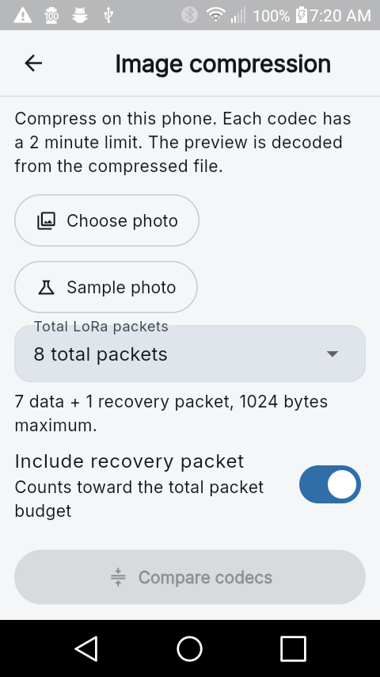
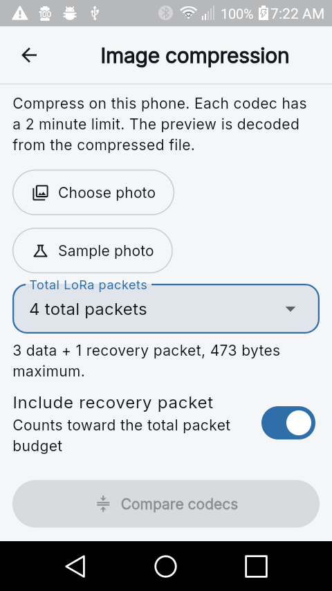
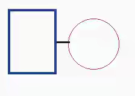
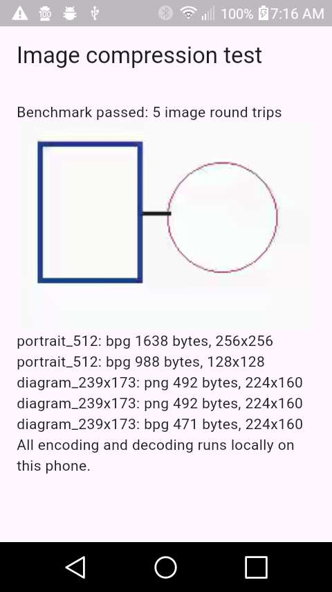
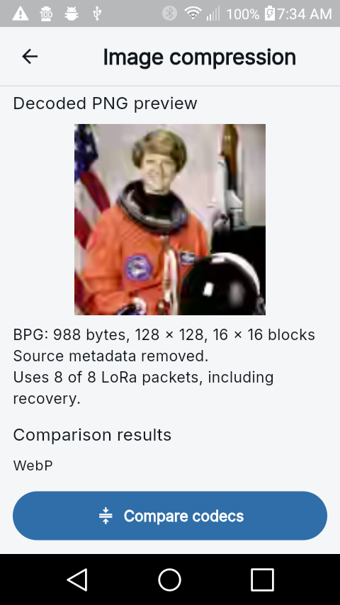

# On-phone image compression and packet budgets

Open Image compression from App Settings or the scanner's Connection and tools menu to test
without a companion. In channel chat, choose Send image to open the same local
compression controls before anything is transmitted.

## Choose the radio cost

- Total LoRa packets is a user-selected maximum, not an instruction to send
  padding. A smaller result sends fewer packets.
- With recovery enabled, choose 2 through 16 total packets. One is the recovery
  packet; the rest carry image data. Without recovery, choose 1 through 15.
- The first data packet carries 157 image bytes and later packets carry 158.
  For example, four total packets with recovery allow 473 image bytes, including
  the compact image header. The maximum is 2369 bytes.
- The default size preset is 1 KB (1024 bytes): at most seven data packets plus
  one recovery packet. A 2 KB preset is also available.
- The app saves the selected target and recovery setting. Changing either
  invalidates an already compressed image; recompress before sending.
- The preview shows the actual packet count and estimated paced sending time.
  These counts describe packets sent by the companion, not the additional
  transmissions made by repeaters forwarding them across the mesh.

The existing chunk format limits an image to 15 data packets. The Send action
checks the actual count in release builds as well as in tests.

## Compression policy

Choose a crop first. The app tries maximum dimensions 512, 384, 256, 192, and
128, in that order. It never silently shrinks below a 128-pixel longest edge.
Within each resolution it compares 16-pixel alignment and, when distinct,
32-pixel alignment. Seam carving removes narrow low-energy seams after cropping
and scaling; it does not invent image content. A codec stops at its first
resolution that fits, comparing both alignments at that resolution.

Quality is searched within the selected byte allowance. Each candidate must
decode successfully before it can win. The app scores the decoded pixels
against the prepared source and displays that decoded result, not the original
photo. This score is a comparison aid, not a guarantee of readable text or
preserved fine detail. If nothing fits at 128 pixels or larger, select more
packets or a different crop.

Android builds include real WebP, JPEG, palette PNG, AVIF, BPG, JPEG XL, JPEG
2000, HEIC, and VVC encoders and decoders. Unsupported platform capabilities are
listed explicitly; they are not silently substituted with a different format.
AEIC uses the existing optional model backend on capable modern devices. Its
model memory requirements cannot fit the Android 5.1 ARMv7 phone; conventional
codecs do not require that model download.

On modern devices with downloaded models, Send AEIC image (generative) remains
a separate channel action using the original AEIC wire format. Its two-minute
deadline returns control and disables further AEIC work until an app restart.
The inference platform plugin cannot guarantee interruption of an in-flight
native call, so this deadline is not a promise that its native computation has
stopped. Use Android's Force stop for a stuck AEIC job before reopening the app;
simply backing out of a screen does not terminate the app process. Conventional
codecs use the killable workers described below.

Pixels are re-encoded without EXIF, GPS, XMP, ICC profiles, comments, or other
source metadata. Only information needed to decode the image is retained. The
receiver decodes the chosen codec locally and creates a fresh PNG for display.
RGB-only formats flatten transparency onto white.

## Bounds and compatibility

Each algorithm gets at most two minutes across all of its compression attempts,
decoding, and scoring. Stop cancels the current worker. Native jobs run in a
separate process with a 192 MiB address-space cap, 512-pixel axis limit, bounded
I/O, and kill-and-reap cancellation. Input image dimensions are checked before
large pixel allocations. Cropping and Dart codecs run off the UI isolate.

Compact images use rate code 2 in the existing image chunk metadata. The payload
begins with a 14-byte MCI1 header containing codec, alignment, dimensions, and a
CRC32. Old AEIC rate codes 0 and 1 keep their existing format. Both endpoints
need an app version that understands compact images; an older receiver cannot
display these new payloads. No companion firmware codec is required.

Single-packet loss recovery and out-of-order reassembly use the existing XOR
parity transport. Two missing data packets still require a retry.

## Reproducible checks

Flutter tests cover packet capacities, saved preferences, minimum resolution,
first-fitting resolution, both block alignments, metadata removal, malformed
inputs, decode bounds, cancellation, deadlines, exact typed-buffer offsets,
receive reassembly, and the send budget check. Small-screen widget tests cover
the selector and reachable Compare/Stop controls.

The developer entry point `lib/image_compression_benchmark.dart` exercises the
production service on public fixtures. It deliberately drops one data packet,
reassembles in reverse order, independently decodes the recovered payload, and
checks that the receiving PNG equals the preview. This is a local transport
loopback, not evidence of an over-air radio transmission.

Native sources, build pins, licenses, and host process tests are documented in
[Native codec notices](../tools/image_codecs/THIRD_PARTY_NOTICES.md).
The optional developer probe requires an explicit Android serial number and
writes only its task-specific directory under `/data/local/tmp`.

## Android 5.1.1 test results

The LGL51AL ARMv7 phone passed all nine native 512x512 codec roundtrips under
the 192 MiB worker cap. The production compression service then passed these
five end-to-end local transport tests, all with one missing data packet:

| Input and budget | Selected format | Dimensions | Image bytes | Total packets |
| --- | --- | --- | --- | --- |
| Photo, 2 KB | BPG | 256x256 | 1638 | 12 |
| Photo, 1 KB | BPG | 128x128 | 988 | 8 |
| Diagram, 2 KB | PNG | 224x160 | 492 | 5 |
| Diagram, 1 KB | PNG | 224x160 | 492 | 5 |
| Diagram, 4 packets including recovery | BPG | 224x160 | 471 | 4 |

All reconstructed PNGs matched the sender preview exactly. The slowest
algorithm comparison took 36.694 seconds, below its two-minute limit. The
complete photo comparisons took about 100-105 seconds on this old phone;
diagram comparisons took about 14-26 seconds. Timing depends on image content
and phone hardware. The app's main-process memory snapshot was about 59 MiB
PSS while a separate worker ran; this snapshot is not a measured peak.

Machine-readable evidence:

- [Production roundtrips](test-results/image-compression/android-5.1-roundtrips.json)
- [Nine native codec probes](test-results/image-compression/android-5.1-native-probe.json)
- [Final APK packaging and hashes](test-results/image-compression/apk-packaging.json)

The full modern Flutter suite passed 1563 tests with 6 skips. The Android 5.1
profile passed 1556 with 13 skips (including intentionally unavailable neural
inference tests). A subsequent native reply-order regression also passed on
both profiles. All 15 Android build-tool tests passed. Both ARMv7 and ARM64
sideload APKs built, with their nine conventional codecs and license assets
verified; the modern APK retains its native inference runtimes. The ARM64 APK
was built and unit-tested, not run on a physical ARM64 phone in this test.
